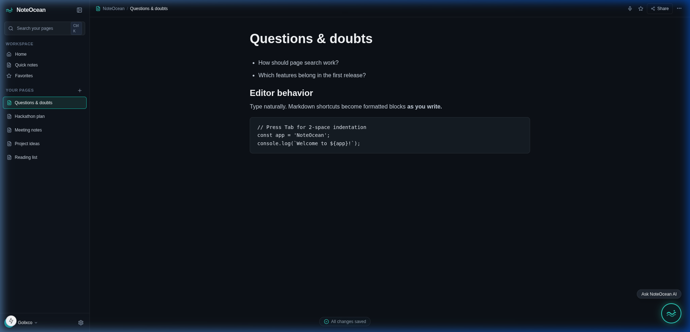
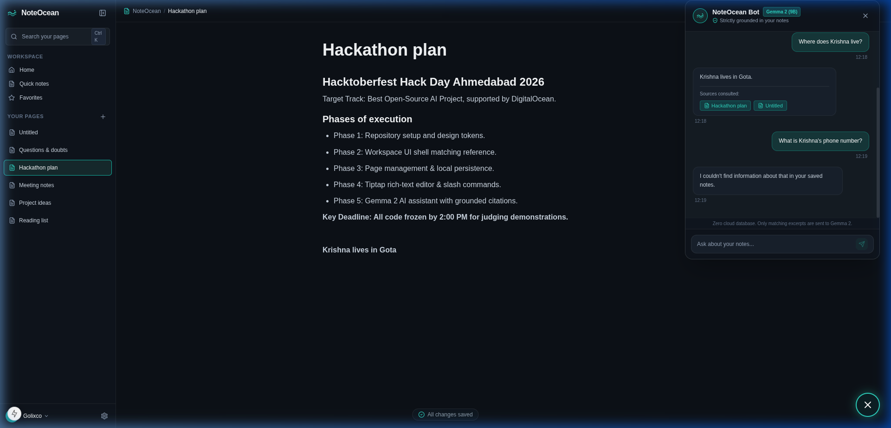
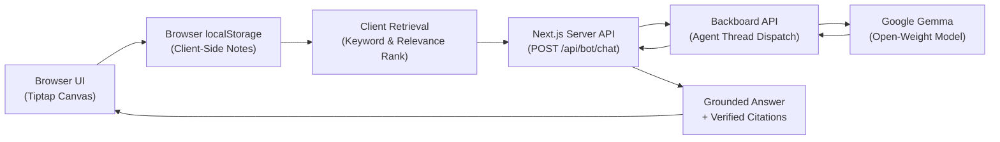

# NoteOcean 🌊

> A modern, fast, AI-powered personal workspace inspired by Notion, featuring instant Markdown transformations, slash commands, real-time title search, browser-local persistence, and an AI assistant strictly grounded in your personal notes.

[](https://noteocean-l222m.ondigitalocean.app/)
[](LICENSE)
[](https://nextjs.org/)
[](https://tailwindcss.com/)
[](https://tiptap.dev/)
[](https://ai.google.dev/gemma)

> 🌐 **Live Application**: **[https://noteocean-l222m.ondigitalocean.app/](https://noteocean-l222m.ondigitalocean.app/)**  
> 📄 **Hackathon Presentation**: **[View Slide Deck (PDF)](assets/presentation/NoteOcean-Hackathon-Presentation.pdf)**

---

## 📸 Screenshots & UI Preview

| NoteOcean Workspace Canvas | Grounded AI Assistant (NoteOcean Bot) |
| :---: | :---: |
|  |  |
| *Fast, zero-login workspace featuring instant Markdown transformations, editable code blocks, and real-time title search.* | *NoteOcean Bot answering queries strictly grounded in saved personal notes with clickable source citations.* |

---

## 📊 Presentation

The official NoteOcean hackathon slide deck details the problem statement, product features, editor interactions, grounded retrieval architecture, privacy boundaries, open-weight Google Gemma integration, and DigitalOcean App Platform deployment.

- 📄 **[View the NoteOcean Hackathon Presentation (PDF)](assets/presentation/NoteOcean-Hackathon-Presentation.pdf)**
<!-- Note: If an editable PowerPoint version (.pptx) is exported, copy it to assets/presentation/NoteOcean-Hackathon-Presentation.pptx -->

---

## 🌊 Overview & Product Vision

**NoteOcean** is built for software engineers, students, and writers who want the rapid, keyboard-first velocity of Markdown coupled with rich block layouts, instant title search, and an AI assistant that answers questions grounded directly in their personal notes.

Most note-taking applications force an unnecessary choice:
1. Bare-bones plain text editors that lack rich structure and visual organization.
2. Bloated, sluggish cloud platforms requiring mandatory account creation, team onboarding, and subscription plans before typing a single note.

**NoteOcean eliminates this friction**:
- **Zero-Login Instant Onboarding**: Open the app and start writing immediately. No signup, no passwords, no OAuth.
- **Immediate Markdown Transformations**: Typing `# `, `## `, `### `, `- `, `1. `, `>`, and `---` immediately transforms blocks on the fly with atomic undo support.
- **Interactive Slash Commands**: Typing `/` opens an accessible, searchable palette anchored at the cursor (`/code`, `H1`, `Bulleted list`, `To-do list`, `Quote`, `Divider`).
- **Real Editable Code Blocks**: Dedicated syntax-styled monospace code blocks with Tab indentation handling and newline isolation.
- **Resilient Local Persistence**: Debounced autosave syncing to browser `localStorage`. Notes survive reloads and browser restarts with zero cloud database dependencies.
- **Real-Time Title Search (`Ctrl+K`)**: Instant client-side search filtering across notes.
- **NoteOcean Bot (Google Gemma via Backboard)**: A floating AI assistant that performs client-side retrieval across your notes and uses open-weight Google Gemma models to answer questions with verifiable source page citations.
- **Privacy First**: Notes remain in your browser's local storage. Only query-relevant snippets are transmitted to the server-side AI endpoint when you submit a question to the assistant.

---

## 🏆 Hackathon Alignment & Target Prize

- **Event**: **Hacktoberfest Hack Day Ahmedabad x Open Source Weekend** (October 24, 2026)
  - [Official Event Page](https://www.mlh.com/events/hacktoberfest-hack-day-ahmedabad-x-open-source-weekend)
  - [Official Challenge Page](https://www.mlh.com/events/hacktoberfest-hack-day-ahmedabad-x-open-source-weekend/challenges/01a0d987-0c41-12ea-13ac-5b85755dc2f3)
- **Primary Target Category**: **Best Open-Source AI Project, supported by DigitalOcean**
  - NoteOcean is an original open-source software project licensed under the permissive MIT license.
  - Powered by open-weight models from Google: **Google Gemma 3 (`gemma-3-27b-it`)** and **Gemma 2 (`gemma-2-27b-it`)** via Backboard API.
  - Hosted on **DigitalOcean App Platform** on the $5/mo Basic plan (512 MiB RAM, 1 shared vCPU) as a lightweight, single-container web service without database overhead.
- **Open-Source Track**: Best Open-Source AI Project, supported by DigitalOcean.

---

## 🎨 UI & Design System

The visual design is grounded in NoteOcean's custom dark ocean design system ([`docs/06-ui-reference-and-design-system.md`](docs/06-ui-reference-and-design-system.md)):
- **Color Palette**: Obsidian background (`#0d1117`), slate sidebar (`#0f141c`), vibrant aquamarine/cyan accent (`#2dd4bf` / `#14b8a6`), active card teal (`#162a2d`).
- **Sidebar**: 250px navigation with NoteOcean wave logo, `Ctrl+K` search bar, Workspace navigation (`Home`, `Quick notes`, `Favorites`), and `YOUR PAGES` list with instant `+` creation.
- **Editor Canvas**: Spacious 780px centered column with seamless 36px bold page title, hover gutter controls (`+`, `:::`), and live Markdown parsing.
- **Slash Palette**: Floating menu positioned near the caret with arrow-key navigation and Enter execution.
- **Save Status**: Bottom-centered indicator (`✓ All changes saved`).
- **Floating AI Assistant**: Glowing circular cyan trigger button (`Ask NoteOcean AI`) in the bottom-right corner opening a grounded chat drawer.

---

## 🧠 AI Architecture: Grounded Note Assistant

### Architecture Overview



> 🔒 **Privacy by Architecture**: Notes are stored exclusively inside the user's browser `localStorage`. No cloud database exists. Only relevant note snippets matching the user's specific query are transmitted to the server-side proxy when asking the assistant.

### Why Google Gemma?
NoteOcean utilizes **Google Gemma** (`google/gemma-3-27b-it` / `google/gemma-2-27b-it`), state-of-the-art open-weight models from Google DeepMind released under the open Gemma Terms of Use. Running Gemma via the Backboard API provides high-fidelity reasoning, compact parameter efficiency, and dependable adherence to grounding instructions within an open-source footprint.

### Retrieval Pipeline & Grounding Flow
1. **User Query**: User opens NoteOcean Bot and asks a question (e.g., *"What is the deadline recorded in my hackathon plan?"*).
2. **Client-Side Keyword Matching**: The client ranks saved notes from `localStorage` using title matches (+10 pts) and body matches (+2 pts).
3. **Context Selection**: The top 3 most relevant matching snippets (or the active page if explicitly queried) are extracted.
4. **Server-Side Proxy (`POST /api/bot/chat`)**: Snippets and question are sent to the Next.js API route. Secrets (`BACKBOARD_API_KEY`) remain strictly on the server.
5. **Untrusted Data Defense**: Notes are wrapped in `<user_notes>` tags with system instructions to treat them strictly as passive data, mitigating prompt injection.
6. **Anti-Hallucination Guardrail**: If the notes do not contain the answer, the model responds: *"I couldn't find information about that in your saved notes."* with zero hallucinated citations.
7. **Clickable Verified Citations**: Responses include cited note badges. Clicking a source citation switches the editor directly to that note. Each citation is verified against active user pages.

---

## 🔒 Security & Privacy Boundaries

- **Browser-Local Data**: All note contents, titles, and IDs are stored in browser `localStorage`. No server database exists.
- **No Credentials in Frontend**: `BACKBOARD_API_KEY` is loaded exclusively by the Next.js backend server from `.env.local` or platform environment variables. It is never exposed in client bundles.
- **Graceful Degradation**: The app functions as a complete, high-speed note editor even when no AI key is configured.
- **Privacy Notice**: Only selected note excerpts matching the user's specific question are transmitted to the AI inference endpoint during active chat inquiries.

---

## 🚀 Getting Started Locally

### Prerequisites
- Node.js 18.x, 20.x, or 24.x
- npm 9+ or 11+

### Installation
1. Clone the repository:
   ```bash
   git clone https://github.com/Golixco/NoteOcean.git
   cd NoteOcean
   ```

2. Install dependencies:
   ```bash
   npm install
   ```

3. Configure environment variables:
   ```bash
   cp .env.example .env.local
   ```
   Edit `.env.local` and add your Backboard API key:
   ```env
   BACKBOARD_API_KEY=your_backboard_api_key_here
   ```
   *(Note: The editor works completely without an API key; configuring it enables live Gemma AI chat).*

4. Start the development server:
   ```bash
   npm run dev
   ```

5. Open [http://localhost:3000](http://localhost:3000) in your browser.

---

## 🧪 Acceptance Testing Matrix

| Test ID | Feature | Description | Status |
| :--- | :--- | :--- | :--- |
| **TC-01** | Zero-Login Onboarding | Instant workspace load with 5 seeded sample notes | Verified |
| **TC-02** | Page Creation | `+` button creates page and autofocuses title | Verified |
| **TC-03** | Local Persistence | Title and body survive browser reload via `localStorage` | Verified |
| **TC-04** | Markdown Rules | `# `, `## `, `### `, `- `, `1. `, `>`, `---`, `**bold**` transform instantly | Verified |
| **TC-05** | Slash Menu | `/code` inserts real editable code block | Verified |
| **TC-06** | Menu Dismissal | `Escape` closes slash palette cleanly | Verified |
| **TC-07** | Code Blocks | Monospace, Tab indents (2 spaces), newlines isolated | Verified |
| **TC-08** | Title Search | `Ctrl+K` real-time filtering with empty state | Verified |
| **TC-09** | AI Grounding | Accurate answers from saved notes with citations | Verified |
| **TC-10** | Anti-Hallucination | Unrecorded questions yield clear negative response | Verified |
| **TC-11** | Speech-to-Text | Optional Web Speech API voice dictation | Stretch |
| **TC-12** | Production Build | Clean linting, typecheck, and `npm run build` | Verified |

---

## 🚢 Deployment — DigitalOcean App Platform

> 🌐 **Live Deployed Application**: **[https://noteocean-l222m.ondigitalocean.app/](https://noteocean-l222m.ondigitalocean.app/)**

NoteOcean is deployed on **DigitalOcean App Platform** using the **Basic Plan** (512 MiB RAM, 1 shared vCPU, 50 GiB bandwidth, estimated at $5.00/month based on current plan pricing; terms and usage can vary).

### Why DigitalOcean App Platform?

1. **Native Next.js 15 Standalone Support**: App Platform runs the Next.js standalone server (`node .next/standalone/server.js`) natively without requiring custom Docker maintenance.
2. **Automated CI/CD**: Pushes to `main` on [GitHub (`Golixco/NoteOcean`)](https://github.com/Golixco/NoteOcean) automatically trigger production builds and seamless rolling redeployments.
3. **Stateless Server Architecture**: By persisting notes client-side in browser `localStorage`, NoteOcean completely eliminates managed database costs and server-side memory bloat.
4. **Built-in Security & Resilience**: Automated TLS/HTTPS termination, DDoS mitigation, and edge routing.

### Deployment Specifications

| Setting | Value |
| :--- | :--- |
| **Live URL** | [https://noteocean-l222m.ondigitalocean.app/](https://noteocean-l222m.ondigitalocean.app/) |
| **Source Repository** | `https://github.com/Golixco/NoteOcean` |
| **Branch** | `main` |
| **Service Tier** | **Basic Web Service** (512 MiB RAM, 1 vCPU, ~$5.00/mo current plan rate) |
| **Build Command** | `npm run build` |
| **Run Command** | `npm run start` *(executes `node .next/standalone/server.js`)* |
| **HTTP Port** | `8080` (or platform `$PORT`) |
| **Database / Workers** | None (Zero cloud database overhead) |

### Environment Variables

| Variable | Type | Purpose |
| :--- | :--- | :--- |
| `BACKBOARD_API_KEY` | **Secret (Encrypted)** | Server-side Backboard API key for Google Gemma inference |
| `NODE_ENV` | Plaintext | `production` |
| `PORT` | Plaintext | `8080` |
| `NODE_OPTIONS` | Plaintext | `--max-old-space-size=384` *(enforces V8 GC before 512 MiB)* |

### Storage Notice

> [!NOTE]
> **Client-Side Storage**: In the current MVP, all notes, titles, and editor blocks are persisted exclusively in the user's browser `localStorage`. Notes are **not** stored in a cloud database or synchronized across devices. The server-side container hosts the Next.js frontend and acts as a secure, stateless proxy for Gemma AI inference.

### 512 MiB RAM Optimization & Performance

- **Idle Memory Footprint**: Standalone server runs at **~99 MB RSS** (standard `next start` runs at **~126 MB RSS**).
- **Available Headroom**: **>350 MB free buffer**, comfortably shielding against memory pressure.
- **V8 Boundary**: `NODE_OPTIONS="--max-old-space-size=384"` guarantees V8 collects heap memory before reaching the container's 512 MiB cgroup limit.

### Deployment Troubleshooting Guide

| Issue | Root Cause | Solution |
| :--- | :--- | :--- |
| **Build Memory Limit Exceeded** | Webpack compilation peak memory spikes | Ensure `NODE_OPTIONS="--max-old-space-size=384"` is set in App Platform environment variables. |
| **Missing API Configuration** | `BACKBOARD_API_KEY` unset | The editor runs without interruption. NoteOcean Bot displays a clear configuration banner indicating that an API key is required. |
| **AI Provider Timeout / Rate Limit** | Upstream model provider capacity | NoteOcean automatically triggers a deterministic fallback that quotes relevant note excerpts directly rather than inventing facts or failing silently. |
| **Port Binding Mismatch** | App Platform expects port `8080` | Next.js standalone server automatically reads the `PORT` environment variable (`PORT=8080`) and binds to `0.0.0.0:8080`. |

---

## 📦 Tech Stack

- **Framework**: [Next.js 15](https://nextjs.org/) (App Router, TypeScript)
- **Styling**: [Tailwind CSS](https://tailwindcss.com/)
- **Editor Core**: [Tiptap v2](https://tiptap.dev/) / ProseMirror
- **Icons**: [Lucide React](https://lucide.dev/)
- **Persistence**: Browser `window.localStorage`
- **AI Engine**: Google Gemma (`gemma-3-27b-it` / `gemma-2-27b-it`) via Backboard REST API
- **Deployment**: [DigitalOcean App Platform](https://www.digitalocean.com/products/app-platform)

---

## 📄 License & Attribution

- NoteOcean is distributed under the [MIT License](LICENSE). Copyright (c) 2026 Rohan Sonu Bablani.
- Google Gemma model weights are governed by Google's open [Gemma Terms of Use](https://ai.google.dev/gemma/terms).
- Built with Google Antigravity pair programming for Hacktoberfest Hack Day Ahmedabad x Open Source Weekend 2026.
