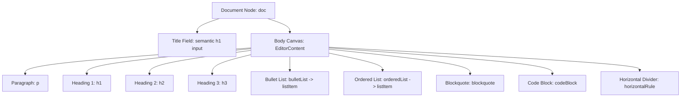
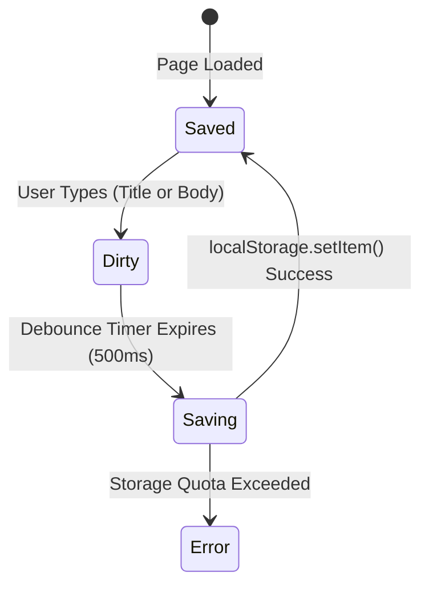

# NoteOcean Editor Interaction Specification (Simplified MVP)

## 1. Overview & Architectural Foundation
This specification defines the exact mechanics, input rules, keyboard handling, caret positioning, and state transitions for the NoteOcean rich-text editor.

The editor is powered by **Tiptap v2** (headless wrapper over **ProseMirror**), providing deterministic document state, transactional transformations, and an undo/redo history graph. Persistence is handled via client-side debounced writes to `window.localStorage`.

---

## 2. Document Schema & DOM Hierarchy



### Title vs. Body Mechanics
- **Page Title**: Managed as a distinct semantic header component (`<input>` or single-line auto-resizing element).
  - Styling: `font-size: 2.25rem` (36px), `font-weight: 700`, line-height `1.2`, borderless, transparent background.
  - Placeholder: `"Untitled"`, rendered in muted slate (`#64748b`).
  - Keybinding `Enter`: Suppresses newline, moves focus to the first block in the body canvas.
  - Keybinding `ArrowDown` at the end of title: Moves focus to the first block of the body canvas.
- **Body Canvas**: Tiptap `EditorContent` mounted inside a centered container (`max-width: 780px`, horizontal auto-margin).
- **Gutter Controls**: Hovering over a block displays a `+` button and a 6-dot drag handle `:::`.

---

## 3. Real-Time Markdown Input Rules

Input rules are evaluated during user typing before characters are committed to the transaction. When the regex matches, the typed trigger characters are consumed and the block or mark transforms immediately.

| Element | Trigger Regex | Action on Match | Caret Behavior |
| :--- | :--- | :--- | :--- |
| **Heading 1** | `/^#\s$/` | Replaces current paragraph with `heading` (level 1). Consumes `#` and space. | Caret placed at start of new `<h1>`. |
| **Heading 2** | `/^##\s$/` | Replaces current paragraph with `heading` (level 2). Consumes `##` and space. | Caret placed at start of new `<h2>`. |
| **Heading 3** | `/^###\s$/` | Replaces current paragraph with `heading` (level 3). Consumes `###` and space. | Caret placed at start of new `<h3>`. |
| **Bullet List** | `/^\s*([-*])\s$/` | Wraps block into `bulletList` item. Consumes `-` or `*` and space. | Caret placed at start of list item. |
| **Numbered List** | `/^\s*(\d+)\.\s$/` | Wraps block into `orderedList` item. Consumes `1.` and space. | Caret placed at start of list item. |
| **Blockquote** | `/^\s*>\s$/` | Wraps block into `blockquote`. Consumes `>` and space. | Caret placed at start of quote text. |
| **Code Block** | `/^```$/` | Converts paragraph into `codeBlock`. Consumes ```. | Caret placed inside code block container. |
| **Divider** | `/^(---|___|\*\*\*)$/` | Replaces line with `horizontalRule`. Auto-inserts paragraph below if at doc end. | Caret moves to the new paragraph below. |
| **Bold** | `/(?:^|\s)\*\*([^*]+)\*\*$/` | Applies `bold` mark to captured text. Strips `**` markers. | Caret positioned directly after formatted text. |
| **Italic** | `/(?:^|\s)\*([^*]+)\*$/` | Applies `italic` mark to captured text. Strips `*` markers. | Caret positioned directly after formatted text. |
| **Inline Code** | `/(?:^|\s)`([^`]+)`$/` | Applies `code` mark to captured text. Strips `` ` `` markers. | Caret positioned directly after inline code. |

### Edge Cases & Invariants
1. **Trailing Space Trigger**: Heading and list input rules strictly require a trailing space (`# `). Typing `#` alone will NEVER transform the block.
2. **Context Suppression**: All Markdown input rules are explicitly disabled when the caret is inside an existing `codeBlock`.
3. **Undo Integrity**: Every input rule replacement creates an atomic step in the ProseMirror `History` plugin. Pressing `Ctrl+Z` / `Cmd+Z` immediately after a transformation reverts the block back to the typed characters (e.g., `# `).

---

## 4. Slash-Command Palette Specification

### A. Invocation & Anchoring
- **Trigger**: Caret types `/` at the beginning of a line or preceded by whitespace.
- **Anchor Point**: Calculated dynamically from ProseMirror view coordinates:
  ```typescript
  const coords = view.coordsAtPos(from);
  // popup positioned at: top: coords.bottom + 6px, left: coords.left
  ```
- **Filter Query**: All characters typed between `/` and the current caret position form the query string (e.g., `/code` -> query `"code"`).

### B. Palette Command Directory

| Key | Label | Description | Action Method |
| :--- | :--- | :--- | :--- |
| `code` | **Code block** | Monospace syntax code container | `chain().focus().toggleCodeBlock().run()` |
| `h1` | **Heading 1** | Large section heading | `chain().focus().setHeading({ level: 1 }).run()` |
| `h2` | **Heading 2** | Medium section heading | `chain().focus().setHeading({ level: 2 }).run()` |
| `h3` | **Heading 3** | Small section heading | `chain().focus().setHeading({ level: 3 }).run()` |
| `bullet` | **Bulleted list** | Unordered bullet point list | `chain().focus().toggleBulletList().run()` |
| `todo` | **To-do list** | Interactive checkbox task item | `chain().focus().toggleTaskList().run()` |
| `quote` | **Quote** | Quotation or callout block | `chain().focus().toggleBlockquote().run()` |
| `divider` | **Divider** | Horizontal visual separator | `chain().focus().setHorizontalRule().run()` |

### C. Keyboard & Focus Rules
1. **Arrow Navigation**:
   - `ArrowDown`: Moves highlight to next item (wraps around).
   - `ArrowUp`: Moves highlight to previous item (wraps around).
2. **Execution**:
   - `Enter`: Deletes the typed `/query` text range, executes the selected command, and focuses the new block.
3. **Dismissal**:
   - `Escape`: Closes popup menu; leaves the `/` character in place.
   - `Backspace`: If query becomes empty and backspace is pressed again, the `/` character is deleted and the menu closes.
   - Pointer click outside: Closes menu without modifying text.

---

## 5. Code Block Specifications

1. **Container Styling**: Dark neutral background (`#151c24` or `#0f141c`), subtle border (`1px solid rgba(255, 255, 255, 0.08)`), rounded corners (`8px`), padding `1rem`.
2. **Typography**: Monospace font family (`ui-monospace, "Fira Code", monospace`), `font-size: 0.875rem` (14px), line height `1.6`.
3. **Tab Key Interception**: Inside a code block, pressing `Tab` must NOT trigger focus shift to the next DOM element. Instead, it inserts 2 space characters (`  `) at the caret.
4. **Enter Key**: Creates a line break (`\n`) within the code block.
5. **Escape Key / Exit**: Pressing `ArrowDown` at the end of the code block or pressing `Enter` twice on an empty final line exits the code block and creates a new paragraph block beneath it.

---

## 6. Debounced LocalStorage Autosave



### Visual Feedback States
- **Clean / Saved**: Centered at bottom of screen: Green/teal circle checkmark + text `All changes saved` (`#8e9fac`).
- **Saving**: Spinner or subtle pulsing indicator + text `Saving changes...`.
- **Error**: Amber/red warning icon + text `Storage full — please export notes`.
