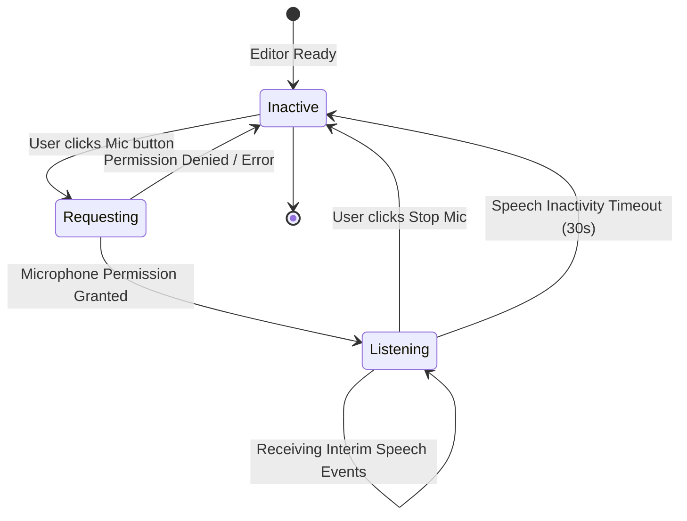

# Speech-to-Text (Voice Dictation) Design Specification

> [!NOTE]
> **Priority Classification: Secondary Stretch Feature (Priority 4)**
> Speech-to-text is an optional enhancement. It must only be built **after** the core rich-text editor, Markdown shortcuts, slash menu, local persistence, title search, and NoteOcean AI Bot are fully operational and verified.
> Speech-to-text must NEVER block delivery of the core editor or AI grounding capabilities.

## 1. Overview & Objective
Note-takers frequently want to capture spontaneous thoughts, meeting dialogues, or lecture fragments hands-free. NoteOcean provides an intuitive voice dictation feature that streams speech-to-text directly into the active editor canvas at the current cursor position.

To prevent speech-to-text from becoming a risky roadblock during tomorrow's hackathon build, this document evaluates three implementation architectures and establishes an explicit, reliable interaction flow.

---

## 2. Comparative Evaluation of Speech-to-Text Approaches

| Dimension | Option A: Browser Web Speech API (Recommended Primary) | Option B: Backboard Voice / Audio Streaming | Option C: Self-Hosted Whisper on DigitalOcean |
| :--- | :--- | :--- | :--- |
| **Technology** | W3C `SpeechRecognition` / `webkitSpeechRecognition` | Server-side STT via Backboard WebSocket / API | `whisper.cpp` / `faster-whisper` on Droplet |
| **Browser Compatibility** | **Native in Chromium / Google Chrome** (our primary target) | Universal across modern browsers | Universal across modern browsers |
| **Latency** | **Real-time instant streaming** (<100ms interim events) | 300ms–800ms streaming chunk latency | 500ms–2000ms depending on CPU/GPU |
| **Operational Cost** | **$0.00** (Free, built into browser engine) | Consumes Backboard API tokens/audio credits | Requires dedicated Droplet CPU/GPU ($24+/mo) |
| **Backend Complexity** | **Zero backend work** (pure client-side hook) | Requires backend audio relay or WebSocket proxy | Requires Docker container, models, Python worker |
| **Interim Transcription** | **Yes**: fires `result` with `isFinal: false` | Supported via WebSocket | Requires custom chunking logic |
| **Privacy & Processing** | Audio processed via browser vendor speech service | Audio sent securely to Backboard service | Audio stays on self-hosted server |
| **Hackathon Viability** | **Optimal**: 45 min implementation, 0 failure risk | Medium: requires streaming audio pipeline | **High risk**: easily blows $25 budget & time |

---

## 3. Recommended Primary Strategy: Web Speech API

### Rationale
Chromium (Google Chrome) has first-class native support for `webkitSpeechRecognition`. It provides real-time word-by-word interim transcripts without requiring server audio streams, WebSocket relays, or third-party paid audio APIs. This ensures zero risk to our hackathon timeline and preserves our cloud credits.

---

## 4. Dictation User Experience & Interaction State Machine

### Step-by-Step Dictation Flow
1. **Initiation**:
   - User positions caret in the editor and clicks the `[🎙️ Dictate]` button in the editor toolbar.
2. **Permission Handling**:
   - The browser requests microphone access if not previously authorized.
   - If denied, a toast notification appears: *"Microphone access denied. Please allow microphone permissions in browser settings."*
3. **Active Listening State**:
   - The microphone button transforms into an active red/cyan pulsing badge (`● Listening...`).
   - Browser audio capture begins.
4. **Interim & Final Transcription**:
   - As words are spoken, `recognition.onresult` fires.
   - **Interim Text**: Displayed in the editor with a subtle underline or italic styling (`font-style: italic; opacity: 0.7`).
   - **Finalized Text**: When `event.results[i].isFinal === true`, the interim styling is removed and the text is committed as standard ProseMirror text nodes.
5. **Termination**:
   - User clicks `[⏹️ Stop Dictating]` or pauses speaking for >10 seconds.
   - `recognition.stop()` is invoked.
   - The media stream is closed and the mic indicator reverts to inactive.
   - Content autosaves automatically via the standard debounced autosave pipeline.

---

## 5. Preventing Common Dictation Bugs & Edge Cases

| Hazard | Prevention Mechanism |
| :--- | :--- |
| **Duplicate Text Insertion** | Separate tracked transcript into `finalTranscript` accumulator and transient `interimTranscript`. Never re-insert previously committed final chunks. |
| **Focus Loss During Speech** | Maintain ProseMirror editor view focus programmatically (`editor.commands.focus(null, { scrollIntoView: false })`) when clicking the mic button. |
| **Accidental Overwrites** | Always insert transcribed tokens at the caret position using `editor.commands.insertContent(text)` rather than replacing the block. |
| **Mic Left Hot** | Add an idle watchdog timer that calls `recognition.stop()` if no speech is detected for 25 continuous seconds. |
| **Non-Chromium Fallback** | Detect availability with `typeof window !== 'undefined' && ('webkitSpeechRecognition' in window || 'SpeechRecognition' in window)`. If unavailable, gracefully disable the mic button with a helpful tooltip: *"Dictation supported in Chrome and Chromium browsers."* |

---

## 6. Future Expansion: Backboard Voice Pipeline (Post-MVP)
If enhanced multi-lingual translation, acoustic punctuation, or speaker diarization is required post-hackathon, the architecture provides a clean upgrade path to Backboard's Voice API (`/sdk/voice`), utilizing an audio chunk upload endpoint `/api/audio/transcribe` that converts audio blobs to text server-side.
