# Hackathon Execution Plan: Tomorrow's Step-by-Step Build (Simplified)

## 1. Execution Philosophy & Time Allocation
The offline hackathon requires disciplined time management and an uncompromising focus on **working end-to-end user experiences** over sprawling infrastructure.

By eliminating database provisioning and user authentication, we have liberated **~3 hours of engineering buffer**, ensuring the core editor and grounded AI bot can be built with exceptional quality and polish.

```mermaid
gantt
    title NoteOcean Implementation Schedule (8 Hours Total)
    dateFormat  HH:mm
    axisFormat  %H:%M
    section Foundation
    Phase 0 — Scaffold & Reference UI: 09:00, 1h
    section Core Editor
    Phase 1 — Editor & Markdown Rules : 10:00, 2h
    section Workspace
    Phase 2 — Sidebar & Title Search : 12:00, 1h
    section Midday Review
    Lunch & Buffer                    : 13:00, 30m
    section AI & Speech
    Phase 3 — NoteOcean AI Bot        : 13:30, 2h
    Phase 4 — Dictation (Stretch)     : 15:30, 45m
    section Deployment & Demo
    Phase 5 — Deploy to App Platform  : 16:15, 1h
    Smoke Tests & Demo Rehearsal      : 17:15, 45m
```

---

## 2. Phased Implementation Roadmap

### Phase 0: Foundation & UI Scaffold (09:00 – 10:00)
- **Goal**: Running Next.js 15 application perfectly matching the visual reference screenshot.
- **Dependencies**: GitHub repository initialized by user; Node 24.
- **Steps**:
  1. Inspect [`NoteOcean/doc/reference/NoteOcean-ui-reference.png`](file:///home/vuld0/NoteOcean/doc/reference/NoteOcean-ui-reference.png) and configure Tailwind CSS variables (`--bg-main: #0d1117`, `--bg-sidebar: #0f141c`, `--accent-cyan: #2dd4bf`).
  2. Initialize Next.js 15: `npx -y create-next-app@latest ./ --typescript --tailwind --app --no-eslint`.
  3. Install core dependencies:
     `npm install @tiptap/react @tiptap/starter-kit @tiptap/extension-placeholder @tiptap/extension-code-block-lowlight lowlight lucide-react`
  4. Build the dual-pane shell: Left sidebar (`250px`) + main editor canvas (`max-width: 780px`).
  5. Seed initial 5 sample notes into `localStorage` if storage is empty.
  6. Verify `npm run dev` renders the clean UI matching the screenshot.

---

### Phase 1: Core Note-Taking & Markdown Engine (10:00 – 12:00)
- **Goal**: Flawless rich-text editor with instant Markdown transforms and debounced local persistence.
- **Dependencies**: Phase 0.
- **Steps**:
  1. Build Page Title component with `Enter` transitioning focus to the editor body.
  2. Mount Tiptap editor with `StarterKit` and custom input rules:
     - `# `, `## `, `### ` (Headings)
     - `- `, `* ` (Bullet list)
     - `1. ` (Numbered list)
     - `> ` (Blockquote)
     - `---` (Horizontal divider)
  3. Build custom floating Slash Command Palette anchored below caret:
     - Shows `Q /code`, active `< / > Code block` item with cyan border and Enter arrow `↵`.
     - Supports `ArrowDown`/`ArrowUp` navigation, `Enter` to execute, `Escape` to dismiss.
  4. Integrate Code Block extension with Tab indentation (2 spaces) and newline handling.
  5. Hook up debounced autosave (`~500ms`) to `window.localStorage`.
  6. Display bottom status indicator: `All changes saved` with teal circle checkmark.
  7. Verify persistence across page refresh (`Ctrl+F5`).

---

### Phase 2: Workspace Management & Title Search (12:00 – 13:00)
- **Goal**: Full page management with instant keyboard search.
- **Dependencies**: Phase 1.
- **Steps**:
  1. Populate sidebar page list from `localStorage` under `YOUR PAGES`.
  2. Add active page styling: rounded card with teal highlight (`#162a2d`, border `1px solid #14b8a6`).
  3. Implement `+` button to create a new page titled `"Untitled"` and focus its title.
  4. Implement real-time search input (`Ctrl+K`): filters visible notes as user types.
  5. Add empty states for "No notes found".

---

### Phase 3: Grounded AI Assistant — NoteOcean Bot (13:30 – 15:30)
- **Goal**: Floating AI drawer answering questions grounded in saved notes with citations.
- **Dependencies**: Phase 2.
- **Steps**:
  1. Build circular floating button with glowing ring at bottom-right (`position: fixed; bottom: 24px; right: 24px`).
  2. Add tooltip badge hovering above button: `"Ask NoteOcean AI"`.
  3. Build slide-up chat drawer with user input and message history.
  4. Implement client-side relevance retrieval matching query terms against saved notes in `localStorage`.
  5. Check Backboard model catalog (`GET https://app.backboard.io/api/models`) to determine if an authentic Gemma 4 model is officially cataloged and enabled. If verified, configure it to target **Best Use of Gemma 4**; otherwise, use the verified **Google Gemma 2 (`gemma-2-9b-it`)** baseline for **Best Open-Source AI Project, supported by DigitalOcean** without adding unnecessary complexity.
  6. Create route handler `POST /api/bot/chat` proxying query + top note snippets to the chosen model, keeping the API key strictly server-side.
  7. Enforce system prompt grounding and prompt injection defense (`<user_notes>`).
  8. Render assistant responses with clickable source citation pills that navigate to the cited note.
  9. Test anti-hallucination guardrail: ask about missing data and verify honest refusal.

---

### Phase 4: Voice Dictation (Stretch Feature) (15:30 – 16:15)
- **Goal**: Hands-free speech-to-text directly inserting into editor.
- **Dependencies**: Phase 1.
- **Steps**:
  1. Add microphone button in editor toolbar.
  2. Connect `webkitSpeechRecognition` hook with listening indicator.
  3. Stream recognized words directly to editor caret.
  4. Handle mic stop and unsupported browser fallback.

---

### Phase 5: Cloud Deployment & Demo Rehearsal (16:15 – 18:00)
- **Goal**: Live production build deployed to DigitalOcean App Platform (preferred target) and tested.
- **Dependencies**: Phases 0–3.
- **Steps**:
  1. Verify zero credentials exist in repository (`git diff`).
  2. Confirm active $25 credit balance and billing status in user's DigitalOcean cloud console.
  3. Push repository to GitHub.
  4. Connect GitHub repository to DigitalOcean App Platform ($5 Basic Tier, 1 dynamic web service) upon user approval.
  5. Configure environment variable `BACKBOARD_API_KEY` in App Platform console.
  6. Monitor build and verify deployment URL.
  7. Execute Acceptance Checklist (TC-01 through TC-12).
  8. Rehearse 3-minute pitch flow with sample notes loaded.

---

## 3. Contingency Plan

If time is constrained during the afternoon:
1. **Drop Phase 4 (Dictation)**: A rock-solid editor + grounded AI bot is 10x more impressive to judges than a buggy voice interface. Dictation is non-critical.
2. **Localhost Demo Fallback**: If App Platform deployment encounters network delays, demo immediately on `localhost:3000` with the exact same codebase.
